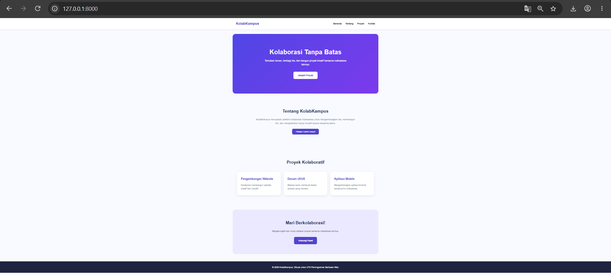

# KOLABKAMPUS
### Landing Page Website Kolaborasi Mahasiswa

**UTS Pemrograman Berbasis Web - 2026**

---

## 1. Deskripsi Proyek

KolabKampus merupakan proyek landing page website
bertema kolaborasi mahasiswa yang dikembangkan sebagai
tugas Ujian Tengah Semester (UTS) mata kuliah
Pemrograman Berbasis Web.

Website ini memperkenalkan konsep platform digital
yang dapat menjadi wadah bagi mahasiswa untuk
berbagi ide, membentuk tim, dan mengembangkan
proyek kreatif secara bersama-sama.

KolabKampus dirancang dengan tampilan sederhana,
modern, responsif, dan mudah digunakan.

## 2. Tema Proyek Kolaboratif

Tema yang diangkat adalah:

**"Kolaborasi Mahasiswa dalam Pengembangan Proyek Digital"**

Tema ini dipilih karena kolaborasi merupakan salah
satu aspek penting dalam dunia pendidikan,
khususnya pada bidang teknologi informasi.

Melalui konsep KolabKampus, mahasiswa diharapkan
dapat saling berbagi pengetahuan, mengembangkan
kreativitas, serta meningkatkan kemampuan
komunikasi dan kerja sama tim.

KolabKampus memperkenalkan tiga bidang
kolaborasi utama:

1. **Pengembangan Website**
   Kolaborasi dalam pembuatan dan pengembangan
   website menggunakan teknologi web.

2. **Desain UI/UX**
   Kolaborasi dalam merancang antarmuka dan
   pengalaman pengguna aplikasi digital.

3. **Pengembangan Aplikasi Mobile**
   Kolaborasi dalam pengembangan aplikasi
   berbasis perangkat mobile.

Website ini masih berupa prototype landing page
yang berfungsi untuk memperkenalkan konsep
KolabKampus kepada pengguna.

## 3. Tujuan Proyek

Tujuan pengembangan KolabKampus adalah:

- Menerapkan materi Pemrograman Berbasis Web.
- Memahami penggunaan framework Laravel.
- Mengimplementasikan Route dan Controller.
- Membuat halaman website menggunakan HTML dan Blade.
- Menggunakan CSS untuk desain responsif.
- Mengimplementasikan interaksi menggunakan JavaScript.
- Menggunakan Git dan GitHub untuk manajemen kode.
- Memperkenalkan konsep kolaborasi proyek digital.

## 4. Teknologi yang Digunakan

| Teknologi | Kegunaan |
|-----------|----------|
| Laravel | Framework pengembangan website |
| PHP | Bahasa pemrograman backend |
| HTML | Struktur halaman website |
| Blade | Template halaman pada Laravel |
| CSS | Desain dan tampilan responsif |
| JavaScript | Interaksi tombol pada website |
| Git | Pengelolaan versi kode |
| GitHub | Penyimpanan repository proyek |

## 5. Fitur Website

Landing page KolabKampus memiliki beberapa bagian:

### A. Navbar
Menu navigasi menuju Beranda, Tentang,
Proyek, dan Kontak.

### B. Hero Section
Bagian pembuka dengan judul
"Kolaborasi Tanpa Batas" dan tombol
"Jelajahi Proyek".

### C. Tentang KolabKampus
Menjelaskan konsep dan tujuan platform
kolaborasi mahasiswa.

### D. Proyek Kolaboratif
Menampilkan tiga kategori proyek:
Pengembangan Website, Desain UI/UX,
dan Aplikasi Mobile.

### E. Interaksi JavaScript
Tombol "Pelajari Lebih Lanjut" untuk
menampilkan dan menyembunyikan
informasi tambahan tentang KolabKampus.

### F. Kontak
Bagian ajakan berkolaborasi dan
contoh tombol kontak melalui email.

### G. Responsive Design
Tampilan website menyesuaikan ukuran
layar desktop, tablet, dan smartphone.

## 6. Screenshot Landing Page

Berikut merupakan screenshot hasil
pengembangan landing page KolabKampus.



## 7. Struktur Proyek

```text
landing-page-kolaboratif-uts/
|
|-- app/
|   |-- Http/
|       |-- Controllers/
|           |-- HomeController.php
|
|-- public/
|   |-- css/
|   |   |-- style.css
|   |-- js/
|       |-- script.js
|
|-- resources/
|   |-- views/
|       |-- home.blade.php
|
|-- routes/
|   |-- web.php
|
|-- screenshots/
|   |-- landing-page.png
|
|-- README.md
|-- artisan
|-- composer.json
```

Struktur tersebut menampilkan file utama
yang digunakan dalam pengembangan landing page.

## 8. Cara Menjalankan Proyek

### Persyaratan

- PHP yang kompatibel dengan versi Laravel proyek
- Composer
- Laragon atau lingkungan PHP lokal lainnya
- Visual Studio Code
- Browser

### Langkah Instalasi

1. Clone repository GitHub ke komputer:

```bash
git clone URL_REPOSITORY
```

Ganti `URL_REPOSITORY` dengan URL repository
yang memiliki izin akses.

2. Masuk ke direktori proyek:

```bash
cd landing-page-kolaboratif-uts
```

3. Instal dependensi Laravel:

```bash
composer install
```

4. Salin file konfigurasi environment.

Pada PowerShell Windows:

```powershell
Copy-Item .env.example .env
```

5. Buat application key:

```bash
php artisan key:generate
```

6. Jalankan server Laravel:

```bash
php artisan serve
```

7. Buka website melalui browser:

http://127.0.0.1:8000

Catatan: Sesuaikan konfigurasi environment
jika diperlukan oleh instalasi Laravel.

## 9. Penerapan Materi Perkuliahan

Proyek ini menerapkan materi yang telah
dipelajari selama perkuliahan, yaitu:

1. Pengantar Pemrograman Berbasis Web
2. Source Code Management menggunakan Git
3. Git Branching dan Merge
4. HTML
5. CSS
6. JavaScript
7. Laravel Route
8. Laravel Controller

Fitur autentikasi Laravel tidak diterapkan
karena proyek difokuskan pada landing page.

## 10. Kesimpulan

KolabKampus merupakan implementasi
pengembangan landing page menggunakan
framework Laravel, HTML, CSS, dan JavaScript.

Proyek ini menunjukkan penerapan
konsep dasar pengembangan website,
pengaturan route dan controller,
pembuatan antarmuka responsif,
serta penggunaan JavaScript untuk
menambahkan interaktivitas.

Selain menjadi media penerapan materi
perkuliahan, KolabKampus juga
memperkenalkan pentingnya kolaborasi
antar mahasiswa dalam menghasilkan
karya digital yang kreatif dan inovatif.

---

**Proyek UTS Pemrograman Berbasis Web**

**Tahun Akademik 2026**
